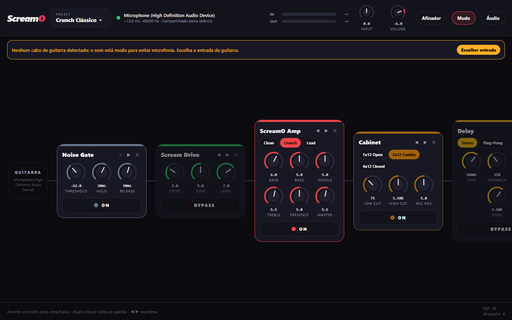

# ScreamO

Pedaleira de guitarra em tempo real para Windows. Conecte a guitarra por um cabo
USB (tipo Behringer Guitar Link, iRig HD, "USB Guitar Cable" genérico ou
qualquer interface de áudio), coloque o fone e toque, **sem instalar driver
nenhum** (nada de ASIO4ALL).



## Como funciona

```
 Cabo USB ──► WASAPI captura ──► Cadeia de efeitos ──► Ponte adaptativa ──► WASAPI saída ──► Fone
 (entrada)    (thread MMCSS)     (Rust, lock-free)     (drift/resample)     (thread MMCSS)
                                        ▲
                                        │ comandos lock-free (rtrb)
                               Controlador + servidor local 127.0.0.1:7777
                                        ▲
                                        │ WebSocket (JSON)
                               UI em React Native (Expo + react-native-web)
```

- **`engine/`**: motor em Rust. Um executável (`screamo.exe`) que abre o áudio,
  roda os efeitos e serve a UI.
- **`ui/`**: interface em React Native (TypeScript). Hoje roda via
  react-native-web numa janela de app do Edge/Chrome aberta pelo próprio motor;
  o mesmo código pode ir para `react-native-windows` (app nativo) no futuro, já
  que a comunicação é só WebSocket.

### Latência sem driver

O áudio usa **WASAPI**, a API nativa do Windows, em três níveis:

| Modo | Como | Latência típica |
|---|---|---|
| Compartilhado baixa latência (padrão) | `IAudioClient3` com o menor período do engine (Windows 10+) | ~10–15 ms ida e volta |
| Exclusivo (opcional) | acesso direto ao hardware, menor período do driver | ~6–10 ms |
| Compartilhado clássico (fallback) | `IAudioClient`, período de 10 ms | ~25–35 ms |

A entrada (cabo USB) e a saída (fone) são dispositivos com relógios diferentes.
Uma **ponte com resampler adaptativo** mantém o buffer no alvo, corrigindo o
drift dos relógios e convertendo taxas diferentes (ex.: cabo em 44,1 kHz, fone
em 48 kHz) sem estalos e sem a latência ir crescendo.

## Efeitos (12)

| Categoria | Efeitos |
|---|---|
| Dinâmica | Noise Gate, Compressor |
| Drive | Scream Drive (estilo TS), Buzzsaw (high gain), Fuzz Face-Off |
| Amp | ScreamO Amp: canais Clean / Crunch / Lead, tone stack, presence |
| Caixa | Cabinet: 1x12 aberta, 2x12 combo, 4x12 fechada, posição do mic |
| EQ | Graphic EQ de 7 bandas |
| Modulação | Chorus estéreo, Tremolo |
| Ambiência | Delay estéreo/ping-pong, Reverb (Freeverb) |

Mais: afinador cromático (YIN), 6 presets de fábrica, presets do usuário,
medidores de entrada/saída, contador de dropouts e carga de DSP.

Os drives e o amp usam **oversampling 4x** nas não-linearidades (menos
aliasing, som menos "digital").

## Rodando

### Usuário

`ScreamO.exe` é um arquivo único (a interface vai embutida), sem instalador e
sem dependências: só o Windows 10/11 e o Edge ou Chrome, que já vêm no sistema.

1. Conecte o cabo da guitarra e o fone.
2. Abra o `ScreamO.exe`. A janela abre sozinha; fechar a janela encerra o
   programa.
3. Se o cabo não for detectado automaticamente, clique em **Áudio** e escolha a
   entrada. Enquanto nenhuma entrada de guitarra for escolhida, a saída fica
   muda, para não gerar microfonia com o microfone do notebook.

Configurações e presets ficam em `%APPDATA%\ScreamO`.

### Desenvolvimento

Pré-requisitos: [Rust](https://rustup.rs) (toolchain `x86_64-pc-windows-gnu`
com [WinLibs MinGW](https://winlibs.com) no PATH, **ou** o toolchain MSVC com
Visual Studio Build Tools) e Node.js 20+.

```powershell
# Build completo: gera dist\ScreamO.exe (UI embutida, ícone, sem console)
.\scripts\build.ps1

# Ou por partes:
cd ui; npm install; npm run build          # UI -> ui/dist (embutida no .exe)
cd engine; cargo run --release             # motor

# UI com hot reload (motor rodando em paralelo):
cd engine; cargo run -- --keep-running     # não fecha junto com a janela
cd ui; npm run web                         # http://localhost:8081
```

Testes do motor (estabilidade de todos os efeitos em 44,1/48/96 kHz, afinador):

```powershell
cd engine; cargo test --release
```

## Adicionando efeitos

Cada efeito é um arquivo em `engine/src/dsp/effects/`. A UI descobre os
parâmetros sozinha. Veja [docs/ADDING_EFFECTS.md](docs/ADDING_EFFECTS.md).

## Pesquisa e decisões

Veja [docs/RESEARCH.md](docs/RESEARCH.md): o que os projetos existentes
(Guitarix, NAM, Rakarrack, go-dsp-guitar, Rustortion, WebAudio Amp Sim...)
fazem e o que o ScreamO faz diferente.

## Roadmap

- [ ] Carregar IR de caixa (.wav) com convolução particionada (FFT)
- [ ] Carregar capturas NAM (Neural Amp Modeler)
- [ ] Tap tempo no delay e sync de BPM
- [ ] Drag & drop para reordenar pedais
- [ ] Looper
- [ ] App nativo com `react-native-windows` + ícone na bandeja
- [ ] Controle por MIDI (pedal de expressão / footswitch)
